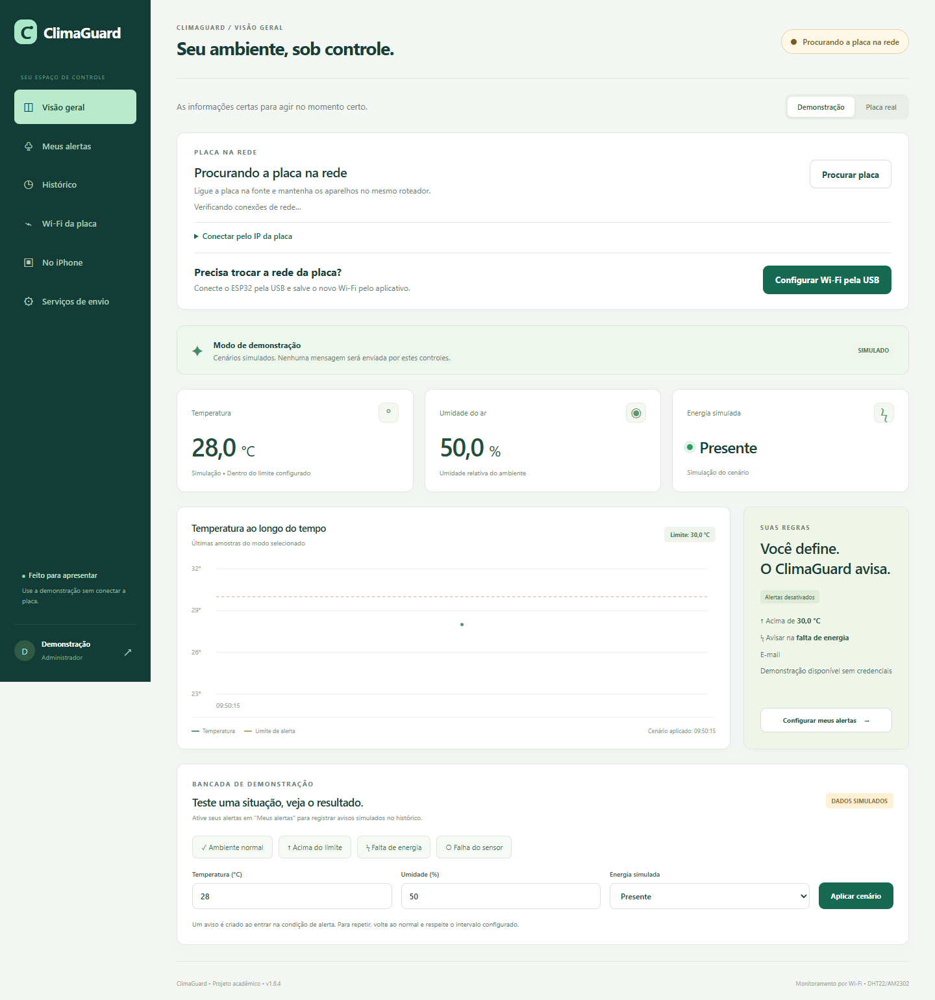

# ClimaGuard

Monitore temperatura, umidade e presença de energia com um **ESP32 DevKit V1**, DHT22/AM2302 e ZMPT101B. O aplicativo Windows recebe as leituras por Wi-Fi e pode enviar alertas por e-mail, SMS e WhatsApp.

## Baixar e começar

**[Baixar ClimaGuard 1.6.5 para Windows 10/11 — 64 bits](https://github.com/ClimaGuard-Equipe/ClimaGuard/releases/download/v1.6.5/ClimaGuard-Instalador-1.6.5-x64.exe)**

**[Manual de instalação com vídeos](manual-de-instalacao/README.md)** · [Passo a passo para instalar e usar](docs/GUIA-DO-USUARIO.md) · [Todas as versões e arquivos](https://github.com/ClimaGuard-Equipe/ClimaGuard/releases)

1. Baixe o instalador pelo link acima e siga o assistente. Python e bibliotecas já estão incluídos.
2. Abra o **ClimaGuard** pelo ícone e crie sua conta.
3. Com a placa já programada, conecte-a por USB e abra **Wi-Fi da placa**. Escolha a porta, informe uma rede de **2,4 GHz** e aguarde **Rede salva na placa**.
4. Conecte também o computador à mesma rede. A placa pode voltar para a fonte USB. Em **Visão geral → Placa real**, aguarde **Placa conectada**.
5. Para receber avisos, configure os serviços e seus destinatários conforme o guia.

O instalador configura o computador; a gravação inicial de uma placa nova é uma etapa técnica separada. Quem recebeu uma placa já preparada pode seguir diretamente o guia do usuário. Para experimentar a interface sem a placa, use **Demonstração**.

*Exemplo em modo Demonstração, com dados simulados.*

## Como funciona

| Parte | Responsabilidade |
| --- | --- |
| ESP32 na fonte USB | Mede os sensores e disponibiliza as leituras na rede local |
| Aplicativo Windows aberto | Mostra e guarda leituras, aplica as regras e processa os envios |
| Roteador ou compartilhamento do celular | Conecta placa e computador na mesma rede |

A placa usa Wi-Fi de 2,4 GHz. O computador pode usar Ethernet ou outra banda do mesmo roteador, desde que os aparelhos consigam se comunicar. Sem comunicação recente, o painel indica indisponibilidade. Fechar o aplicativo ou suspender o computador interrompe o acompanhamento e os envios.

## Recursos e limites

- Descoberta da placa, conexão por IP, indicador de comunicação e gráfico.
- Contas locais com acesso às configurações compartilhadas de envio. Cada conta tem suas próprias preferências e seu histórico de alertas.
- Troca de Wi-Fi pela USB para qualquer conta local autenticada. A configuração permanece na placa após desligar.
- E-mail com Resend, SMS com Twilio e WhatsApp por WPPConnect ou Twilio. Cada serviço precisa ser configurado; custos e restrições dependem do provedor.
- WPPConnect exige Chrome ou Edge instalado e vinculação pelo QR Code. É uma integração não oficial do WhatsApp, sujeita a mudanças e desconexões.
- Demonstração com eventos identificados como simulados, sem enviar mensagens externas.
- ZMPT101B começa desativado e informa **energia não verificada** até a montagem correta e a calibração. A calibração atual detecta presença/ausência de AC; não é uma medição de tensão em volts.
- A entrega de mensagens depende da internet e do serviço. **Aceito pelo serviço** não confirma recebimento.

## Montagem e primeira gravação

Use o [guia do ESP32 DevKit V1 e ZMPT101B](docs/ESP32-DEVKIT-ZMPT.md). O DHT22 usa GPIO4; a entrada analógica do ZMPT101B usa GPIO34/ADC1 com adaptação de tensão adequada.

**A montagem da parte de 127/220 V exige pessoa qualificada, isolamento e proteção física. Não conecte a saída de um módulo de 5 V diretamente ao GPIO do ESP32.** Para começar sem essa etapa, use somente temperatura e umidade ou o modo Demonstração.

O instalador não grava firmware nem instala o driver USB da placa. A equipe técnica deve preparar placas novas conforme [DESENVOLVIMENTO.md](docs/DESENVOLVIMENTO.md). O firmware mantém compatibilidade com a NodeMCU ESP8266 e sua chave simuladora, documentada em [Montagem anterior](docs/legado/MONTAGEM-NODEMCU.md).

## Mais instruções

| Assunto | Guia |
| --- | --- |
| Vídeos: montagem da placa, instalação e configuração | [Manual de instalação](manual-de-instalacao/README.md) |
| Instalar, conectar e resolver problemas comuns | [Guia do usuário](docs/GUIA-DO-USUARIO.md) |
| Instalação, atualização e arquivos locais | [Windows](docs/INSTALADOR.md) |
| Trocar a rede | [Wi-Fi da placa](docs/TROCAR-WIFI.md) |
| Notificações pelo WhatsApp local | [WPPConnect](docs/WHATSAPP-LOCAL.md) |
| Alternativa com provedor | [WhatsApp com Twilio](docs/WHATSAPP.md) |
| Consultar a placa diretamente pelo Android | [Android — acesso local](docs/ANDROID.md) |
| Acompanhar pelo Safari com PC e Tailscale | [iPhone](docs/IPHONE.md) |
| Código, testes, compilação e publicação | [Desenvolvimento](docs/DESENVOLVIMENTO.md) |

## Dados e privacidade

Cada computador mantém suas próprias contas, preferências, histórico e credenciais em `%LOCALAPPDATA%\ClimaGuard`. Atualizar ou desinstalar o programa preserva essa pasta. O EXE público começa sem os dados pessoais do computador de desenvolvimento.

Use o sistema em uma rede de confiança. As leituras da placa ficam disponíveis na rede local; o painel de configuração do Windows é local. Não encaminhe as portas do aplicativo ou da placa para a internet. O recurso para iPhone utiliza um acesso privado separado com Tailscale.

Senhas de Wi-Fi, contas, chaves de serviços e sessões de WhatsApp não devem ser enviadas ao GitHub. Consulte a [política de segurança](SECURITY.md).

## Projeto e colaboração

Projeto acadêmico mantido pela [equipe ClimaGuard](https://github.com/ClimaGuard-Equipe). Veja [como colaborar e registrar autoria](docs/COLABORACAO.md). A organização é responsável pela licença do código próprio; as dependências distribuídas mantêm suas respectivas licenças e avisos.
