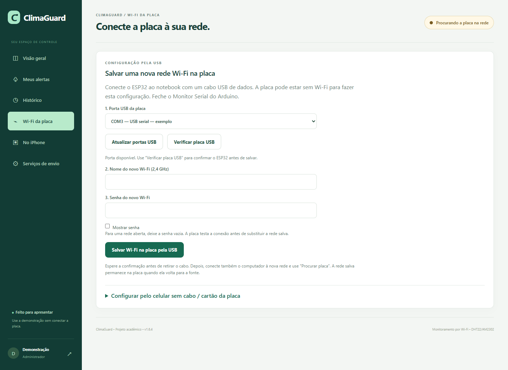

# Instalar e usar o ClimaGuard

Este guia é para quem vai usar o aplicativo no Windows, sem programar. A primeira configuração leva alguns passos; depois basta ligar a placa e abrir o programa.

## 1. Separe o necessário

- Computador com Windows 10 ou 11 de **64 bits**.
- Placa ESP32 DevKit V1 **já programada com o ClimaGuard**, sensor DHT22/AM2302 e montagem conferida pela equipe.
- Cabo USB **de dados** para configurar a rede pela primeira vez e fonte USB para o uso diário.
- Nome e senha de uma rede Wi-Fi de **2,4 GHz**. Pode ser um roteador ou o compartilhamento de internet de um celular.
- Internet para baixar o aplicativo e para enviar notificações. O monitoramento local depende da comunicação na rede, não de uma conta de provedor.

**Placa nova, sem o programa?** Peça à equipe para fazer a [gravação inicial](DESENVOLVIMENTO.md#preparar-uma-placa-nova). O instalador Windows não realiza essa gravação.

O ZMPT101B é opcional para começar: temperatura, umidade e Demonstração funcionam sem ele. A parte de 127/220 V precisa ser montada e protegida por pessoa qualificada. Não ligue sinal de 5 V diretamente ao GPIO34; veja a [interface de baixa tensão e a calibração](ESP32-DEVKIT-ZMPT.md).

## 2. Baixe o arquivo correto

1. Abra a [página da versão 1.6.4](https://github.com/ClimaGuard-Equipe/ClimaGuard/releases/tag/v1.6.4).
2. Na área **Assets / Arquivos**, baixe **ClimaGuard-Instalador-1.6.4-x64.exe**. Você também pode usar o [download direto](https://github.com/ClimaGuard-Equipe/ClimaGuard/releases/download/v1.6.4/ClimaGuard-Instalador-1.6.4-x64.exe).
3. Aguarde o download terminar. Os arquivos **Source code** são destinados a quem desenvolve o projeto; para instalar, escolha o EXE.

O programa é uma compilação do projeto e ainda não tem assinatura digital própria. O Windows ou o navegador podem exibir um aviso. Confira que o arquivo veio desta organização no GitHub; se a política do seu computador impedir a instalação, procure o responsável por ele. Não é necessário desativar o antivírus.

## 3. Instale e abra

1. Dê dois cliques no EXE baixado.
2. Siga o assistente. Mantenha a opção **Criar ícone na área de trabalho** selecionada se quiser um atalho.
3. Ao terminar, abra **ClimaGuard** pelo ícone ou pelo menu Iniciar.
4. Se o Microsoft WebView2 estiver ausente, o assistente usa o instalador oficial da Microsoft; mantenha a internet disponível nessa etapa.

Você não precisa instalar Python, Git, Arduino IDE ou abrir um terminal para usar uma placa já preparada. O aplicativo é instalado para seu usuário do Windows.

## 4. Crie sua conta

1. Na tela inicial, clique em **Criar conta**.
2. Informe nome, e-mail e uma senha com pelo menos oito caracteres. Confirme a senha e conclua.
3. A primeira conta criada nesse computador será **Administradora** e terá acesso a **Serviços de envio**. As demais mantêm suas preferências de alertas e podem configurar o Wi-Fi da placa pela USB.

Essa é uma conta local do ClimaGuard. Ela não cria uma conta nos serviços de e-mail, SMS ou WhatsApp. Anote sua senha em um local seguro; não há recuperação automática por e-mail nesta versão.

## 5. Salve o Wi-Fi na placa

Faça esta etapa quando a placa for para outra rede ou ainda não tiver a rede correta salva.

1. Com a montagem elétrica conferida e a parte AC desconectada, conecte a placa ao computador com o cabo USB de dados. Não use duas fontes de alimentação ao mesmo tempo sem uma montagem preparada para isso.
2. No ClimaGuard, abra **Wi-Fi da placa**, no menu lateral. Também existe **Configurar Wi-Fi pela USB** na Visão geral.
3. Em **Porta USB da placa**, escolha a porta encontrada, por exemplo **COM9**. Se não aparecer, clique em **Atualizar portas USB**.
4. Clique em **Verificar placa USB**. A mensagem deve identificar uma placa ClimaGuard. Feche o Monitor Serial do Arduino se ele estiver aberto.
5. Digite o nome exato do Wi-Fi de **2,4 GHz** e a senha. Maiúsculas, acentos e espaços fazem parte do nome; não acrescente espaços ao copiar. Para uma rede aberta, deixe a senha vazia.
6. Clique em **Salvar Wi-Fi na placa pela USB** e aguarde a confirmação. Não retire o cabo durante a tentativa.
7. Quando aparecer **Rede salva na placa**, a placa já terá testado e guardado a nova rede. Se a conexão for recusada, confira a mensagem; a configuração anterior é preservada quando a tentativa falha.
8. Conecte também o computador à mesma rede. Depois, retire a placa do computador e ligue-a à fonte USB de uso diário.

Em compartilhamento por celular Android, use 2,4 GHz ou o modo de compatibilidade e permita conectar novos aparelhos. No iPhone, habilite **Maximizar Compatibilidade**. Redes de visitantes ou com isolamento de aparelhos podem impedir que o computador enxergue a placa, mesmo que ambos tenham internet.

Para trocar a rede sem cabo e usar o cartão de configuração, veja [TROCAR-WIFI.md](TROCAR-WIFI.md).

*A porta COM3 da imagem é um exemplo. Selecione a porta encontrada no seu computador.*

## 6. Veja as leituras

1. Abra **Visão geral** e selecione **Placa real**.
2. Clique em **Procurar placa** e aguarde. Se houver várias placas, escolha a correta na conta administradora.
3. **Placa conectada**, em verde, indica comunicação com leituras novas.
4. Confira temperatura, umidade e horário da última leitura. O DHT22 é medido aproximadamente a cada 2,1 segundos.

O computador pode estar conectado por cabo Ethernet ou por Wi-Fi de 5 GHz do mesmo roteador. A placa permanece em 2,4 GHz. O roteador precisa permitir a comunicação entre esses aparelhos.

Se a busca automática não encontrar e você souber o endereço atual, a conta administradora pode usar **Conectar pelo IP da placa**. Use o IP informado pela sua placa; o endereço de outro computador ou de um exemplo não funciona. O roteador pode mudar o IP depois de reiniciar.

## 7. Entenda o estado de energia

| Texto na tela | Significado |
| --- | --- |
| Energia presente | O sensor configurado detectou o sinal AC |
| Energia ausente | O sensor configurado confirmou ausência do sinal AC |
| Não verificada | O sensor está desativado, sem calibração ou sem uma leitura válida |
| Sem dados / sem comunicação | O aplicativo não recebeu leituras recentes da placa |

**Não verificada não significa falta de energia.** A configuração do ZMPT101B é feita após conferir a montagem e calibrar com uma condição conhecida de energia presente. A etapa está no [guia do sensor](ESP32-DEVKIT-ZMPT.md).

A calibração atual detecta presença/ausência; ela não apresenta uma medição de 127 ou 220 V. A placa precisa continuar alimentada para informar a ausência de energia. Se ela também desligar, o painel indicará perda de comunicação.

## 8. Configure os alertas

O monitoramento já funciona sem configurar os serviços de envio. Para receber mensagens:

1. Entre na conta **Administradora** e abra **Serviços de envio**.
2. Configure somente os canais que pretende utilizar e salve. Ative **Envios reais** quando as credenciais estiverem prontas.
3. Abra **Meus alertas** na conta que receberá as mensagens.
4. Ative os alertas, escolha as condições, o limite de temperatura, o intervalo e os canais.
5. Informe o e-mail e/ou telefone. No telefone, use **+**, código do país, DDD e número, sem espaços. Exemplo fictício: `+5511912345678`.
6. Marque a autorização de notificações reais e clique em **Salvar minhas preferências**.
7. Na área **Enviar uma mensagem de teste**, teste cada canal configurado e confira o **Histórico** e o recebimento no destinatário.

### E-mail

Configure a chave da sua conta Resend e um remetente permitido por ela. A chave deve ser obtida pelo responsável pelo serviço e inserida somente no aplicativo. Remetentes e destinatários permitidos dependem da conta configurada.

### SMS

Configure sua conta Twilio e o remetente SMS. Contas de teste têm restrições e podem aceitar somente mensagens predefinidas. Custos e permissões precisam ser conferidos pelo responsável pela conta.

### WhatsApp pelo notebook

1. Com Chrome ou Edge instalado, escolha **WPPConnect** em Serviços de envio.
2. Clique em **Conectar WhatsApp / atualizar QR Code**.
3. No celular, abra **WhatsApp → Aparelhos conectados → Conectar um aparelho** e leia o QR Code mostrado no ClimaGuard.
4. Aguarde o estado conectado e faça um teste pelo ClimaGuard.

Não é necessário contratar uma API para essa opção. Ela usa uma integração não oficial, sujeita a mudanças, desconexões ou bloqueios. O computador precisa permanecer ligado, com internet e o aplicativo aberto. Veja [o guia do WhatsApp local](WHATSAPP-LOCAL.md). A alternativa com Twilio está [neste guia](WHATSAPP.md).

O histórico diferencia tentativas e resultados. **Aceito pelo serviço** significa que o serviço aceitou o pedido, sem garantir que o destinatário já recebeu. Os alertas usam controle de repetição; uma condição contínua não envia a mesma mensagem a cada leitura.

## 9. Uso diário e demonstração

No uso real, ligue a placa na fonte, mantenha o computador na mesma rede, abra o ClimaGuard e selecione **Placa real**. Para continuar recebendo e enviando, mantenha a janela aberta e o computador sem suspensão.

Para uma apresentação sem a placa, selecione **Demonstração** e use os cenários da tela. Os dados e avisos serão identificados como simulados e esses controles não enviam mensagens externas.

## 10. Resolver problemas comuns

| Problema | O que conferir |
| --- | --- |
| Nenhuma porta USB | Cabo de dados, outro conector USB e driver compatível com o chip da placa, obtido pelo responsável técnico |
| Não foi possível acessar a USB | Feche Monitor Serial e outros programas que usam a porta |
| Nome e senha corretos, mas não conecta | Rede 2,4 GHz, permissão para novos aparelhos, limite do compartilhamento e mensagem específica do aplicativo |
| Wi-Fi salvo, mas placa não aparece | Conecte computador e placa à mesma rede e clique em Procurar placa; confira isolamento de clientes |
| Placa conectada, sem temperatura/umidade | Peça à equipe para conferir alimentação, GPIO4 e montagem do DHT22 |
| Energia não verificada | Confira montagem, divisor e calibração do ZMPT101B; a indicação não prova falta de energia |
| Botões de teste desativados | Confira serviços, Envios reais, canais escolhidos, destinatários e autorização salva |
| WhatsApp desconectado | Verifique internet, Chrome/Edge e refaça a vinculação pelo QR Code |
| Aplicativo não abre / porta 5000 ocupada | Feche a outra instância ou o processo de desenvolvimento e abra o ClimaGuard novamente |
| Funcionava e parou após fechar a tampa | O computador pode ter suspendido; mantenha-o acordado durante o monitoramento |

Se precisar de ajuda, anote a versão, o texto do erro e o que estava fazendo. O menu **Aplicativo → Abrir pasta de dados** contém o registro `aplicativo.log`. Revise e remova dados pessoais antes de compartilhar qualquer registro. Nunca publique senhas, chaves ou a pasta inteira de dados.

## 11. Atualizar, desinstalar e usar outro computador

Para atualizar, feche o ClimaGuard e execute o instalador da nova versão obtido em [Releases](https://github.com/ClimaGuard-Equipe/ClimaGuard/releases). Reabra pelo ícone. Contas, preferências e histórico são preservados na pasta `%LOCALAPPDATA%\ClimaGuard`.

Para desinstalar, use **Configurações do Windows → Aplicativos → ClimaGuard → Desinstalar**. A pasta de dados permanece no computador; a desinstalação não apaga as contas nem o histórico.

Em outro computador, instale normalmente e crie uma conta local. Ele precisa estar na mesma rede da placa. As configurações de envio são próprias de cada instalação; se configurar vários computadores para enviar, cada um poderá processar seus próprios alertas.

O Android tem um aplicativo separado para consultas locais; veja [ANDROID.md](ANDROID.md). No iPhone, o acesso pelo Safari pode usar o computador e Tailscale; veja [IPHONE.md](IPHONE.md). O instalador Windows não transforma sozinho a placa em um serviço acessível pela internet.
