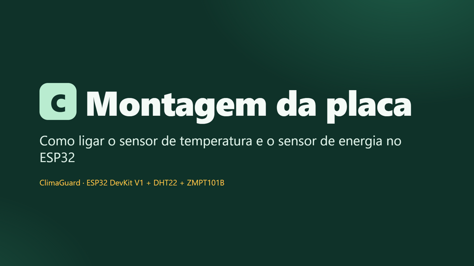
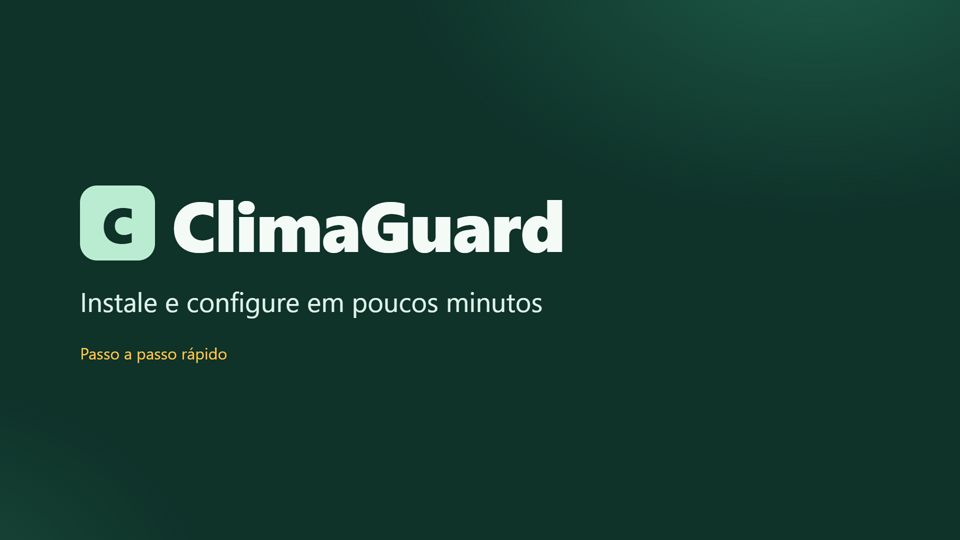
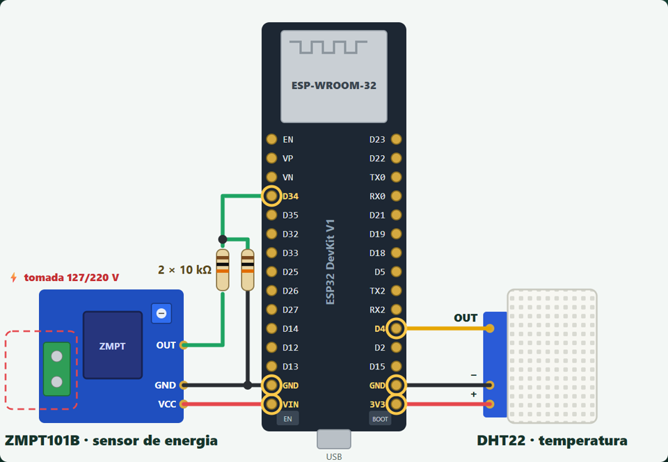

# Manual de instalação do ClimaGuard

Passo a passo em vídeo para montar a placa, instalar o programa e receber o primeiro alerta. Os vídeos têm narração em português e legendas (`.srt`).

## Vídeos

| Vídeo | Conteúdo | Duração |
| --- | --- | --- |
|  **[1. Montagem da placa](videos/montagem-da-placa.mp4)** · [legendas](videos/montagem-da-placa.srt) | Pinos do ESP32, ligação do DHT22 e do ZMPT101B, segurança da tomada e calibração do sensor de energia | 3 min 07 s |
|  **[2. Instalação e configuração](videos/instalacao.mp4)** · [legendas](videos/instalacao.srt) | Baixar e instalar o programa, criar a conta, salvar o Wi-Fi na placa, ver as leituras e configurar os alertas | 2 min 34 s |

Para assistir, abra o vídeo e clique em **View raw** (ou no botão de download). Quem já recebeu a placa montada e programada pode começar pelo vídeo 2.

## 1. Montagem da placa

**Antes de começar:** faça as ligações com a placa desligada do USB. A entrada da tomada do ZMPT101B (127/220 V) só pode ser ligada por professor ou técnico, com isolamento e caixa fechada. Nunca ligue fio da tomada na protoboard, nos pinos ou no GND do ESP32.

Materiais: ESP32 DevKit V1 (30 pinos), DHT22/AM2302, ZMPT101B, 2 resistores de 10 kΩ, fios jumper, protoboard e cabo USB de dados.

| Sensor | Pino do sensor | Pino do ESP32 |
| --- | --- | --- |
| DHT22 (temperatura e umidade) | + | 3V3 |
| | OUT (dados) | D4 (GPIO4) |
| | − | GND |
| ZMPT101B (energia) | VCC | VIN (5 V do USB) |
| | GND | GND |
| | OUT | 10 kΩ até D34 (GPIO34) e outro 10 kΩ de D34 até GND |

- DHT22 de 4 pernas, sem placa: coloque também um resistor de 4,7 kΩ entre DATA e 3V3.
- Os dois resistores de 10 kΩ formam um divisor que reduz o sinal de até 5 V para no máximo 2,5 V, dentro do limite do ESP32.
- O sensor de energia começa desativado. Depois da montagem conferida e com energia presente na tomada, segure **BOOT** por 3 segundos, conecte o celular à rede **ClimaGuard** da placa, abra `http://192.168.4.1/power`, marque a confirmação e toque em **Calibrar e ativar**.

Detalhes técnicos, limites e calibração: [ESP32 DevKit V1 e ZMPT101B](../docs/ESP32-DEVKIT-ZMPT.md). A gravação inicial do programa numa placa nova está em [Desenvolvimento](../docs/DESENVOLVIMENTO.md#preparar-uma-placa-nova).

## 2. Instalação e configuração

1. **Baixe** o [ClimaGuard 1.6.5 para Windows](https://github.com/ClimaGuard-Equipe/ClimaGuard/releases/download/v1.6.5/ClimaGuard-Instalador-1.6.5-x64.exe).
2. **Instale:** dê dois cliques no arquivo e siga o assistente até **Concluir**. Se o Windows avisar, clique em **Mais informações → Executar assim mesmo**.
3. **Crie sua conta** na primeira tela. Anote a senha.
4. **Salve o Wi-Fi na placa:** conecte a placa pelo cabo USB, abra **Wi-Fi da placa**, escolha a porta, clique em **Verificar placa USB**, digite o nome e a senha de uma rede **2,4 GHz** e clique em **Salvar Wi-Fi na placa pela USB**.
5. **Mesma rede:** conecte o computador à mesma rede e ligue a placa no carregador USB.
6. **Veja as leituras:** em **Visão geral**, escolha **Placa real** e clique em **Procurar placa**.
7. **Alertas:** em **Meus alertas**, ative os alertas, escolha o limite de temperatura, os canais e os contatos. Em **Serviços de envio**, configure e-mail, SMS ou WhatsApp, marque **Envios reais ativados** e faça um teste.

Guia completo, com a solução de problemas comuns: [Instalar e usar o ClimaGuard](../docs/GUIA-DO-USUARIO.md).

## Sobre os vídeos

As telas do programa foram capturadas do ClimaGuard 1.6.5 em modo Demonstração. As telas da porta USB e da placa conectada são exemplos ilustrativos, e os diagramas de ligação são desenhos baseados no guia de montagem e no firmware. A narração foi gerada localmente com o motor OmniVoice do [VoiceStudio](https://github.com/debpalash/VoiceStudio), cujos pesos são licenciados apenas para uso não comercial.
